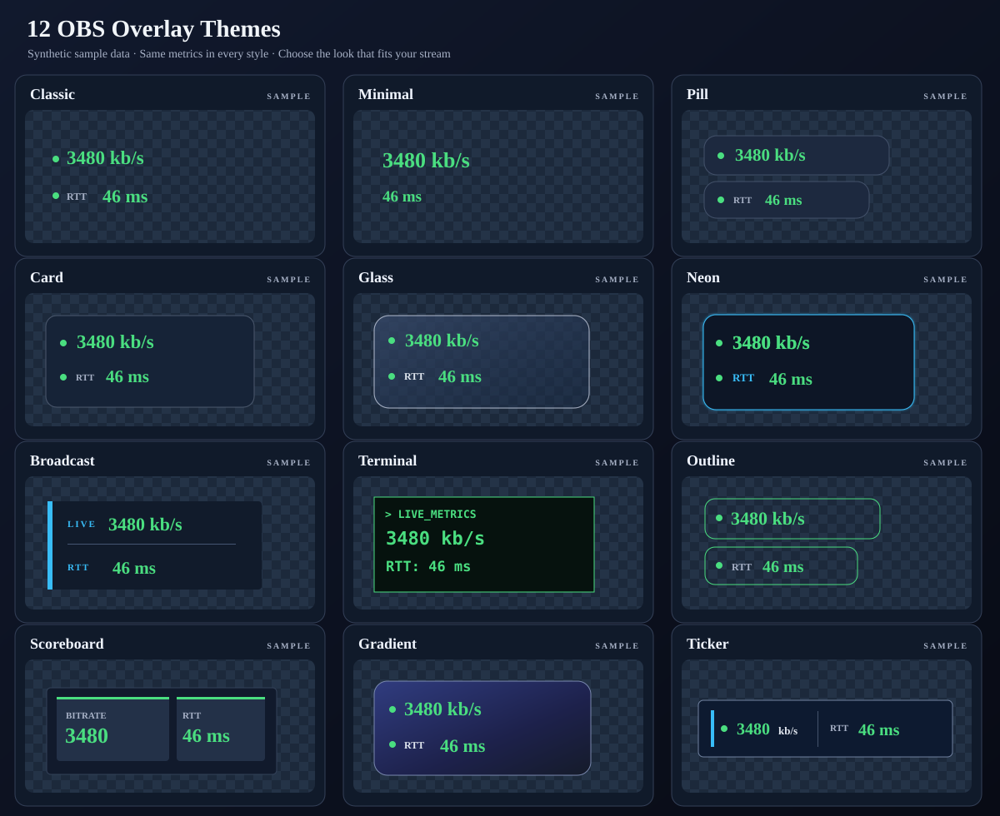

# Stream Server Bitrate Overlay

A lightweight, single-file, transparent HTML overlay for **OBS Browser Sources**. Show live bitrate, RTT and optional OpenIRL SRTLA connection details with server fallback and custom visual presets. No build step or external JavaScript libraries.

## Visual OBS Overlay Builder (GitHub Pages)

**[Open the visual builder (after GitHub Pages is enabled)](https://alexanderwagnerdev.github.io/stream-server-bitrate/)** or open [`index.html`](index.html) using a local web server (`python3 -m http.server 8000`; then visit `http://localhost:8000/`). The builder is a standalone static website requiring **no database, login, third-party service, analytics or API access**. It does not send your stats keys anywhere; all configuration happens inside your browser.

The builder includes:

- **Bitrate and RTT history graphs** with up to 600 in-memory samples, colored lines, optional area fill, configurable history length and auto/fixed scale. Offline polls create gaps rather than plotting incorrect zero values. A 60-sample history at a 2-second poll interval represents roughly two minutes.
- **Toggleable widgets** for current bitrate, RTT, online/offline state, stream uptime (if provided by the API), OpenIRL throughput/SRTLA connections, a bitrate progress bar, a bitrate history graph and a separate RTT graph.
- **Reorderable widgets** (move up/down), six independent metric layouts (`vertical`, `horizontal`, `compact`, `grid`, `split`, `dashboard`) and 12 visual theme presets.
- Advanced **appearance controls**: colors, background transparency, typography, number/label sizing, spacing, position, framing, offline text, bitrate units, metric indicator shape, and style.
- **Multiple fallback servers**; configurable source type, stats URL, stats/player key, status labels and refresh/timeout values.
- Configurable bitrate/RTT color thresholds, a live **synthetic-data preview** (no stats endpoint contacted), adjustable OBS preview dimensions, JSON settings import/export and **downloadable standalone OBS HTML file** with settings included.

To use the generated result in OBS: download the HTML, create a Browser Source, enable **Local file**, select the downloaded HTML and match its preview width and height in OBS. No external chart library or runtime dependency is necessary; the graph uses inline SVG. The generated overlay can also be used as a hosted page only if the hosting configuration protects the stats key and permits browser cross-origin access.

**GitHub Pages deployment:** after merging the PR, configure repository Settings → Pages → **Source: GitHub Actions**. The `Deploy overlay builder to GitHub Pages` workflow packages the static frontend and deploys on pushes to `main`. The website will typically be at `https://alexanderwagnerdev.github.io/stream-server-bitrate/`, but is **not live until Pages is enabled and deployment succeeds**. The [GitHub Actions overlay tests](.github/workflows/tests.yml) also capture real browser screenshots of both the theme gallery and the generator as downloadable artifacts.

**Security and limitations:** The editor never fetches your real stats endpoint. The browser preview deliberately receives *only appearance, widget and threshold settings*, not URLs or keys. Your downloaded HTML/JSON does contain credentials needed to access stream stats; don't commit those files to public GitHub repositories or share them publicly. CORS and mixed-content restrictions apply when OBS accesses real stats endpoints. Stream graphs are session-local, reset when OBS reloads the page, and skip data while offline.

## Supported server stats

| Type | Stats format | URL/key |
| --- | --- | --- |
| `SRT` | Traditional SRT-Live-Server `{publishers: {...}}` JSON | `page` + `publisher` path |
| `OpenIRL` | **OpenIRL SLS modern stats**, for both standard SRT and SRTLA | `/stats/<player_id>` (use `page` + `key`) |
| `OpenRTMP` | OpenRTMP `librtmp2-server` public JSON | `/stats?key=<stats_key>` |
| `NMS` | Node-Media-Server JSON | `page` |
| `NGINX` | nginx-rtmp `/stat` XML | `page` + `key` application tag |

**Important:** `SRT` in the configuration means the **traditional SLS stats format**, *not* "all streams using the SRT protocol." OpenIRL SLS, whether receiving regular SRT or SRTLA, should use `type: "OpenIRL"` when its modern `/stats/<player_id>` API is available.

### OpenIRL SRT vs SRTLA

Both use the same public endpoint and expose `publisher.bitrate` (kb/s) and `publisher.rtt` (ms). When valid SRTLA stats are available, the server **overrides** `publisher.bitrate` with its aggregated `totalBitrate` and adds `publisher.peers[]` with per-link bitrate, throughput, jitter (ms) and uptime. The publisher RTT is from the underlying SRT stats and **is not a per-peer RTT**. The overlay uses the server-provided aggregate, **never sums link bitrates** to guess the total. Peer information is optional and may not be present on every OpenIRL deployment.

The deprecated OpenIRL `?legacy=1` format instead uses `publishers.live` and lacks peer details; configure the modern endpoint **without** `legacy=1`.

## Setup

Download [bitrate.html](bitrate.html), open it in a text editor, and change the `servers` array at the beginning of its `<script>` section.

```js
const interval = 2000;
const request_timeout = 4000;

const servers = [
  // Try OpenIRL SLS first. The "key" here is the player ID.
  { type: "OpenIRL", page: "http://127.0.0.1:8080/stats", key: "live",
    show_rtt: true, show_label: true, peer_display: "details", max_peers: 4 },

  // Fall back to OpenRTMP. The "key" is the per-stream stats_key.
  { type: "OpenRTMP", page: "http://127.0.0.1:8081/stats", key: "sts_your_stats_key",
    show_rtt: true, show_label: true },

  // Traditional SRT-Live-Server format (if you use that implementation):
  // { type: "SRT", page: "http://127.0.0.1:8181/stats",
  //   publisher: "publish/live/test", show_rtt: true },

  // { type: "NMS", page: "http://127.0.0.1:8000/api/streams/live/feed1" },
  // { type: "NGINX", page: "http://127.0.0.1/stat", key: "live" },
];
```

Only the **first server with a valid positive bitrate** is displayed. When the current server is offline, the next is tried on each poll. Fetch requests have a timeout, and polls do not overlap. A zero bitrate means no signal. For an OpenIRL server you can also supply `page: "http://127.0.0.1:8080/stats/live"` without `key`. For OpenRTMP you can supply the complete `page: "http://127.0.0.1:8080/stats?key=sts_..."` without a separate `key`.

### Per-server options

| Option | Description |
| --- | --- |
| `type` | One of `SRT`, `OpenIRL`, `OpenRTMP`, `NMS`, `NGINX` |
| `page` | HTTP(S) stats URL |
| `publisher` | Traditional SLS publisher path (only for `SRT`) |
| `key` | OpenIRL **player ID**; OpenRTMP **stats key**; NGINX application tag |
| `label` | Custom label when `show_label: true` |
| `show_label` | Show the server label next to the bitrate |
| `show_rtt` | Show RTT when the source supplies it |
| `show_throughput` | Show raw network throughput for OpenIRL, if supplied |
| `peer_display` | OpenIRL SRTLA only: `"off"` (default), `"count"`, or `"details"` |
| `max_peers` | Number of SRTLA peer rows in `"details"` mode (default 4, max 16) |

SRTLA details show **LINK 1**, **LINK 2**, etc. with bitrate and jitter; the number of peer rows and all measurements come from the server, not from inferred connections. Individual links are deliberately displayed in a neutral color because the overall bitrate thresholds do not apply to each link in isolation.

## Overlay designs: 12 themes + interactive previews



**[Open the interactive theme gallery](examples/themes.html)** – download this repository and open `examples/themes.html` in a browser. Each card embeds **the actual overlay**, with fake bitrate/RTT values so you can compare designs safely without a running server or stats credentials. Try horizontal vs vertical layout, accent colors, status indicators, text size, and example SRTLA connection details. The SVG above is a design contact sheet; the gallery is the live-rendered source of truth.

| Preset | Visual style |
| --- | --- |
| `classic` | Original transparent, color-coded bitrate and RTT |
| `minimal` | Bare numbers, no status dot |
| `pill` | Rounded individual metric capsules |
| `card` | One rounded, dark statistics card |
| `glass` | Frosted translucent surface and subtle blur |
| `neon` | Accent outline and glowing measurements |
| `broadcast` | Flat lower third with a prominent accent bar |
| `terminal` | Monospace retro command-line display |
| `outline` | Transparent metric frames |
| `scoreboard` | Segmented counter blocks for event or studio overlays |
| `gradient` | Accent-tinted gradient panel |
| `ticker` | Compact horizontal information ribbon |

All themes work with every configured server source; none requires a particular bitrate API. Change the `design` object in `bitrate.html`:

```js
const design = {
  preset: "neon",                  // One of the 12 preset names above
  layout: "vertical",              // vertical | horizontal
  align: "right",                  // left | center | right
  font_family: "'Segoe UI', 'Inter', system-ui, sans-serif",
  font_size: 22,                   // Main value, px
  label_size: 11,
  font_weight: 700,
  gap: 4,
  row_padding: "6px 12px",
  padding: "6px 10px",             // Outer OBS padding
  corner_radius: 12,
  border_width: 1,
  background: "rgba(12, 18, 30, 0.82)",
  border_color: "rgba(255, 255, 255, 0.15)",
  accent_color: "#38bdf8",
  letter_spacing: 0,
  indicator_size: 8,
  indicator_style: "dot",          // dot | square | bar | none
  text_shadow: true,
  show_dot: true,                  // Existing option; false hides all dots
  show_bitrate_label: false,
  show_units: true,
  bitrate_unit: "kb/s",            // kb/s | Mb/s
  mbps_decimals: 2,
  offline_text: "NO SIGNAL",
  colors: {
    green: "#4ade80",
    orange: "#fb923c",
    red: "#f87171",
    muted: "rgba(255, 255, 255, 0.65)",
  },
};
```

On pull requests, the **Overlay tests** GitHub Actions workflow also captures an **actual Chrome screenshot** of the complete theme gallery. Open the latest successful workflow run and download the `obs-overlay-design-previews` artifact. Unlike the illustrative SVG above, this PNG is captured directly from `examples/themes.html` running the real overlay previews.

The selected preset provides a layout and decorative frame. Your own colors, labels, font sizes, background opacity, and status threshold settings still apply. `classic` remains the backward-compatible default; the existing `show_dot` field is still supported.

### Local preview with synthetic statistics

You can also open a **single** design directly, without configuring any server:

```text
bitrate.html?demo=1&preset=glass
```

`demo=1` is opt-in and only displays known synthetic values; it performs **no stats requests**. Remove the demo query parameter to use live data in OBS. Additional *demo-only* parameters: `layout=horizontal`, `indicator=bar`, `fontSize=26`, `accent=%2338bdf8`, `srtla=1`. For permanent settings, edit the `design` object. Never use a URL with `demo=1` as the live OBS source.

Thresholds are independent of the display unit:

| Status | Bitrate | RTT |
| --- | --- | --- |
| Green | > 2500 kb/s | < 120 ms |
| Orange | 1200–2500 kb/s | 120–249.999 ms |
| Red | ≤ 1200 kb/s | ≥ 250 ms |

Adjust these in the `thresholds` object: `bitrate_orange`, `bitrate_red`, `rtt_orange`, `rtt_red`.

## OBS Browser Source

1. Add a **Browser Source** in OBS.
2. Enable **Local file** and select `bitrate.html`.
3. Set its dimensions to fit your chosen preset (for example 300 × 100 for classic; increase height when showing individual SRTLA links).
4. Optionally enable **Shutdown source when not visible**.

### Cross-origin access (CORS)

HTML overlays use the browser's `fetch` API. The stats server must be **reachable from the device running OBS** and must allow the Browser Source origin through CORS.

- OpenIRL SLS sends `Access-Control-Allow-Origin: *` on its stats responses.
- **OpenRTMP's current HTTP server does not expose a CORS response header**. If OBS loads the overlay as a local file (`file://`) or from a different origin, the browser may block fetching OpenRTMP stats. Configure a same-origin reverse proxy or an explicitly permitted CORS header for `/stats` on your own server. Do **not** disable browser security globally.
- A locally running server inside Docker is not necessarily `127.0.0.1` from the OBS computer. Use the actual reachable address.
- An HTTPS-loaded overlay cannot fetch an HTTP endpoint if mixed-content rules block it; use HTTPS for stats too.

OpenRTMP's `stats_key` grants access to stream statistics, so treat overlay files and URLs containing it as sensitive. **Never embed an OpenRTMP admin API bearer token** in this public overlay. Similarly, OpenIRL uses the *player ID*, not an admin API key.

## Tests

Tests use Node.js 22 or later without external packages:

```sh
node --test tests/overlay.test.cjs
```

GitHub Actions runs the test suite on pull requests and pushes to `main`.

## License

MIT — see [LICENSE](LICENSE). Originally based on [b3ck/server-bitrate-html](https://github.com/b3ck/server-bitrate-html).

---

# Deutsch – Kurzanleitung

Ein konfigurierbares OBS-Bitrate-Overlay mit automatischem Server-Fallback, 12 Design-Presets, Bitrate-/RTT-Verlaufsgraphen und einem visuellen Generator.

- **OpenIRL SLS (SRT und SRTLA):** `{ type: "OpenIRL", page: "http://server:8080/stats", key: "player_id", show_rtt: true }`. Bei SRTLA können mit `peer_display: "count"` oder `"details"` die Verbindungen und deren Bitraten/Jitter eingeblendet werden. Die Gesamtbitrate stammt direkt vom Server; RTT ist die Publisher-RTT, nicht die RTT jeder Verbindung.
- **OpenRTMP librtmp2-server:** `{ type: "OpenRTMP", page: "http://server:8080/stats", key: "sts_...", show_rtt: true }`. Hier ist `key` der Stats-Key, kein API-Token. Bei Browser-Quellen **CORS beachten**, siehe oben.
- **Altes SRT-Live-Server-JSON:** `type: "SRT"` erwartet ausdrücklich `publishers[publisher]`, nicht das moderne OpenIRL-Format.
- **Darstellung:** 12 Presets: `classic`, `minimal`, `pill`, `card`, `glass`, `neon`, `broadcast`, `terminal`, `outline`, `scoreboard`, `gradient` und `ticker`. Zusätzlich einstellbar: Ausrichtung, Schrift, Farben, Abstände, Transparenz, Akzentfarbe, Rahmen, Status-Indikator sowie kb/s oder Mb/s. **[Beispielbilder](docs/theme-previews.svg)** und **[interaktive Vorschau](examples/themes.html)** (Repository herunterladen und lokal öffnen).
- **Schwellenwerte:** Bitrate grün über 2500, orange bis 2500, rot bis 1200 kb/s. RTT grün unter 120, orange ab 120, rot ab 250 ms. Beide unter `thresholds` anpassbar.

In OBS eine Browser-Quelle mit **Lokale Datei** hinzufügen und `bitrate.html` oder die **generierte HTML-Datei** auswählen. Im [visuellen Generator](index.html) lassen sich Server, Schwellenwerte, Graphen, Widgets, Reihenfolge, Layouts, Designs und Darstellung einstellen. Über GitHub Pages erreichbar, sobald der PR gemergt, Pages aktiviert und das Deployment erfolgreich ist. Alternativ lokal mit `python3 -m http.server 8000` starten. Keine externen Bibliotheken nötig.
